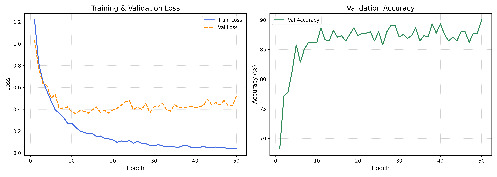

# 🏭 Industrial Pump Telemetry Classification with PyTorch

A deep learning pipeline built with PyTorch to classify the operational status of industrial pumps based on multivariate sensor telemetry.

## 📌 Project Overview
Predictive maintenance is critical in industrial environments to prevent pump failures and reduce downtime. This project processes sensor telemetry data, trains a deep multi-layer neural network with regularization, and evaluates performance using balanced classification metrics.

## 🧠 Key Features & Best Practices
- **Data Hygiene:** 70/15/15 stratified train-val-test split; feature scaling fitted exclusively on the training set to prevent data leakage.
- **Modern Architecture:** Multi-layer feedforward network with `BatchNorm1d`, `GELU` activations, and `Dropout`.
- **Training Pipeline:** Optimized with `AdamW`, model checkpointing on lowest validation loss, and memory-efficient `torch.inference_mode()`.
- **Evaluation:** Evaluated with Classification Report (Precision, Recall, F1-Score) and Confusion Matrix visualization.

## 📊 Results

### Training & Validation Dynamics



## 🚀 How to Run
1. Install dependencies:
   ```bash
   pip install -r requirements.txt
